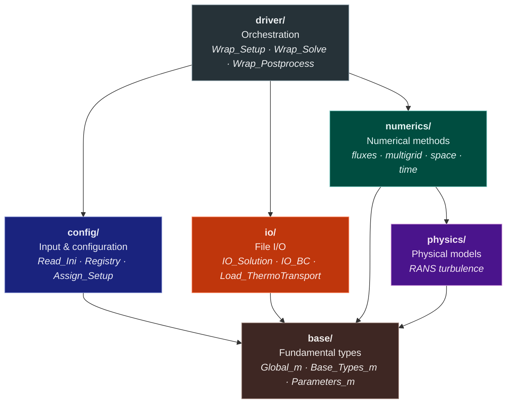
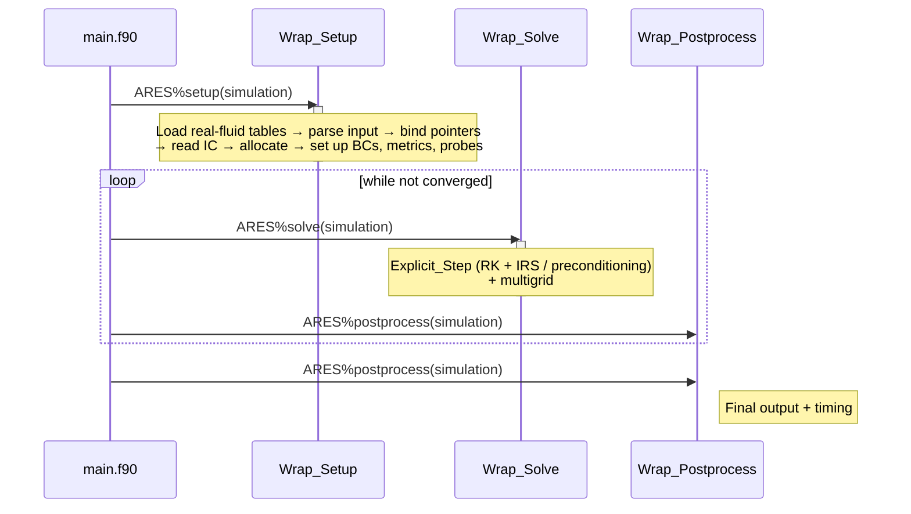

# Code Structure

This page documents the repository layout, the internal architecture of the ARES library, and the solver execution pipeline.

---

## Repository Layout

```
ARES/
├── CMakeLists.txt           # Top-level CMake build
├── CMakePresets.json        # Developer presets (compilers, paths)
├── install.sh               # build / compile / update helper
├── mkdocs.yml               # Documentation site configuration
│
├── src/
│   ├── app/                 # Executables
│   │   ├── main.f90         #   ARES solver entry point
│   │   └── docgen.f90       #   Input-parameter documentation generator
│   ├── lib/                 # ARES library (libARES)
│   │   ├── base/            #   Fundamental types, parameters, globals
│   │   ├── config/          #   Input parsing, registry, setup assignment
│   │   ├── diagnostic/      #   Residual monitoring
│   │   ├── driver/          #   High-level orchestration (Wrap_*)
│   │   ├── io/              #   File I/O (solution, BCs, probes, walls, thermo)
│   │   ├── numerics/        #   Numerical methods
│   │   │   ├── fluxes/      #     convective/diffusive flux, riemann/, bc/
│   │   │   ├── multigrid/   #     restriction / prolongation
│   │   │   ├── space/       #     metrics, reconstruction, limiters, ghosts
│   │   │   └── time/        #     dt + explicit/ (RK, IRS, preconditioning, newstate)
│   │   ├── parallel/        #   MPI / OpenMP communication helpers
│   │   └── physics/         #   Physical models
│   │       ├── turbulence/  #     RANS models (SA, SST, Wilcox, QCR, SSGLRR)
│   │       └── Lib_Prt_Correction.f90
│   └── test/                # Unit-test scaffold (built with BASIC_TEST=ON; currently empty)
│
├── lib/                     # External dependencies (git submodules)
│   ├── FLINT/               #   Real-fluid thermodynamic tables (bundles the OSLO ODE library)
│   ├── ORION/               #   Structured-grid I/O library
│   └── third_party/
│       └── FiNeR/           #   INI file parser
│
├── test/                    # Validation test suite (flat plates, HTD, Prt-correction, common/ tooling)
├── cmake/                   # CMake modules (compiler flags, OpenMP/MPI)
├── bin/                     # Built executables (ARES, DocGen)
└── build/                   # Build artefacts
```

---

## Dependencies

**Required submodules** (always linked, located in `lib/`):

| Library | Purpose |
|---------|---------|
| `FLINT` | Real-fluid thermodynamic & transport tables (ships the OSLO ODE solver library under `lib/FLINT/lib/OSLO`) |
| `ORION` | Structured multi-block grid I/O |
| `FiNeR` | INI file parser |

Optional compile-time dependencies (TecIO, SUNDIALS, Cantera) are enabled via the `install.sh build` flags (`--use-tecio`, `--use-sundials`, `--use-cantera`), which record the corresponding cache variables in `CMakePresets.json` for the submodule builds.

---

## Library Architecture

The ARES library (`libARES`) is organised in layers; lower layers know nothing of higher layers.



---

## Solver Pipeline

`src/app/main.f90` creates an `ARES_type` object and calls three phases: **setup**, **solve** (in a loop), and **postprocess**.



### Explicit step

Each `Explicit_Step` performs one time step:

1. **Compute Δt** — local/global steps from one additive rule of the convective (CFL) and diffusive (VNN) rates, summed over the directions (preconditioned signal speed when `prec` is active; on a 2-D wedge also the hoop stress of the wedge faces; in time-accurate RANS runs also the stiffness of the turbulence sources).
2. **Runge–Kutta loop** (`n_RK` stages):
    - Fill ghost cells (boundary + inter-block; those of the walls and `400` faces by `Ghost_Wall`).
    - Compute the viscous variables of the cells and of their first layer of ghost cells (`Viscous_Variables`, viscous runs).
    - Evaluate convective fluxes (reconstruction → Riemann solver).
    - Evaluate diffusive fluxes.
    - Apply boundary fluxes: first one flux per face between blocks (`Connection_Fluxes`), then every boundary record.
    - Add RANS source terms (if turbulent), with the ghost cells of the fluxes.
    - Update state via `Newstate` (optional IRS smoothing + RK combination + thermo inversion).
3. **Compute residual** (pressure residual) and write diagnostics.

The RK stages run inside one OpenMP parallel region. The MPI calls made inside it (the halo
exchange in `Fill_Ghost_Cell`, the flux of the faces between blocks whose two cells are on different
ranks in `Connection_Fluxes`, the velocity gradient of the rotation–curvature correction (SA-RC,
SST-RC) in `Ghost_Velocity_Gradient`, the residual exchange of the implicit residual smoothing) are made
by the primary thread only, in `!$omp master` blocks (OpenMP 5.1 added the `masked`
construct and deprecated `master`), each followed by an explicit
`!$omp barrier` wherever the other threads use its result. ARES initialises MPI with
`MPI_THREAD_FUNNELED`, which allows MPI calls only from the thread that initialised MPI, and that
thread is the primary thread of the region. A `single` block may run on any thread of the team,
so it must not contain MPI calls.

At set-up `Setup_Metrics` computes the metrics of the cells of the blocks of each rank, and of their
ghost cells, inside OpenMP parallel regions. A degenerate or inverted cell raises a flag shared by the
threads (set in a critical section): the first thread of the rank that finds one writes it, and after
the region every rank stops together (the largest of the flag over the ranks, then the collective stop),
so that the message is written once and the exit code is 1. With symmetry (`300`) on the two faces of an
index direction that has fewer than two cells (the $k$ faces of a 2-D case, the $j$ faces of a 1-D case),
the second layer of ghost cells of each face copies the first layer of the other: `Setup_Metrics` fills
the ghost layers of the symmetry faces one layer at a time, each after the previous layer of every face,
so their metrics do not depend on the number or on the order of the threads. With `diffusive-metric = mean` the
viscous flux of a face of type `200` (`BC_Rotational_Periodic_Visc`) takes the inverse-mean metric of the cell and of
its image, which depends on the mesh only: `Setup_Metrics` computes it once (`Rotational_Periodic_Face_Metric`) and
stores it in the record (`bc%rM`), and `BC_Fluxes` passes it. At its end `Setup_Metrics` computes, for the records of
the walls and `400` faces, the ratio of the MUSCL distances behind the face (`Extrapolation_Ratio`, `bc%sx`, on every
rank), and with `stencil` the face metrics of the viscous fluxes and the cell metrics of the source terms
(`Setup_Stencil_Metrics`, [Diffusive Flux Evaluation](#diffusive-flux-evaluation)). A viscous run on a wedge or a
sector closed by type `200` whose boundary faces on the axis have zero area stops there (`Check_Wedge_Axis`), and so
does, with `mean`, a viscous run on a 3-D mesh with a boundary face of zero area (a polar line).

---

## Convective Flux Evaluation

The convective flux at each interface is built in stages from a 4-point stencil:

1. **MUSCL reconstruction** — interface left/right states using the selected limiter.
2. **Riemann solver** — one of six solvers resolves the jump (`Mod_Riemann` binds `Riemann => …`).
3. **Numerical flux** — multiplied by the interface area vector.

---

## Diffusive Flux Evaluation

The viscous and conductive flux of an interior face comes from `Diffusive_Flux`
(`numerics/fluxes/Lib_Diffusive.f90`), which takes the face metric as one argument:

```fortran
call Diffusive_Flux ( normal, area, waldis1, waldis2, rough1, rough2,           &
                      Prim1, Prim2, Visc1, Visc2, Visc3, Visc4, Visc5, Visc6,   &
                      Visc7, Visc8, Visc9, Visc10, Mf, Res1, Res2, a, b, c,     &
                      Sc, Sct, Prt, Prt_corr, Mg )
```

`Prim1` and `Prim2` are the primitive variables of the two cells, from 1 to 2 along the normal (the state of the face is
their mean); `Visc1` and `Visc2` their viscous variables, `Visc3`–`Visc6` and `Visc7`–`Visc10` those of their neighbours
along the two tangential index directions `b` and `c` (cell 1 at -1 and +1, then cell 2 at -1 and +1); `a` is the
direction across the face. The viscous variables of a cell are its velocity, temperature (from the tables) and turbulence
variables per unit mass (`Visc_State`, `Lib_Diffusive.f90`), the quantities whose differences make the gradients.
`Viscous_Variables` (`numerics/fluxes/Mod_Fluxes.f90`) computes them once per stage, after the ghost cells are filled, for
every cell of the blocks of the rank and for the first layer of ghost cells across the faces of each block, into
`blk%Visc`; the viscous fluxes of the interior faces and of the faces of types `101`, `201`, `102` and `200` read them there
(the cells of the other block of a face between blocks, `bc%Pg`, are computed on the face). `Mf(3,3)` is the face metric:
the gradient is `Gradient(v,:) = matmul(D(v,:), Mf)`, with `D` the difference across the face and the two tangential
differences. `Mg(3,3,4)`, optional, holds one face metric per group of quantities (1 unused, 2 temperature, 3 velocity,
4 turbulence variables) where a ghost cell of a wall is in the stencil, whose values sit at different positions
(`Ghost_Wall`). `Res1` takes -flux and `Res2` +flux.

`Fluxes_blk` (`Mod_Fluxes.f90`) chooses the metric with `metric = obj_space_scheme%metric_mode` (`METRIC_MEAN` 0,
`METRIC_STENCIL` 2, from `diffusive-metric`): with `stencil` it passes the metric stored at setup in
`blk%dir(d)%Mf(i,j,k)%c` by `Setup_Stencil_Metrics` (`numerics/space/Lib_Stencil_Metrics.f90`, called at the end of
`Setup_Metrics`, on every multigrid level) itself, through a contiguous pointer (no copy), with `blk%dir(d)%Mg` where
`blk%dir(d)%ig` names a column; with `mean` it computes the mean of the cell metrics `blk%M` of the two cells.

Boundary faces with `stencil`: a face between blocks (`101`, `201`) takes one gradient through `Diffusive_Flux`
(`BC_Connection_Visc_Stencil`), with the metric stored on the face of the block of the record and the tangential
neighbours of the ghost cell from `bc%Pg(:,3:6)`; a symmetry face (`300`) uses the stored metric of the cell and its
mirror image in `BC_Symmetry_Visc` (the metric of the cell with one cell across the face). A wall face takes the metric
and the tangential differences of the wall temperature that `Wall_Face_Stencils` stores in its record (`bc%wstencil`,
`bc%wM`, `bc%wdT`): `BC_Wall_Temperature` and `BC_Wall_Heat` read them through their optional argument `rec`, which every
caller passes (`BC_Fluxes`, the wall output). Faces of type `200` (`BC_Rotational_Periodic_Visc`) take one gradient
through `Diffusive_Flux` with `stencil`, with the metric that `Rotational_Face_Metric` stores on the face of the block
(one per group of quantities with a wall ghost cell in the row of the cell or of the source; the image row is the row of
the source turned, positions and values), and with `mean` the inverse-mean metric of the record (`bc%rM`); the routine
chooses by `obj_space_scheme%stencil_metric`, so every caller passes `bc%rM`. Chimera faces (`102`) keep their own
metric with every option. The positions of the ghost cells that enter the metric are listed in
[Spatial Discretization](../theory/numerics.md#face-metric-stencil).

The source terms of the turbulence models and the eddy viscosity of the output take their cell metrics from
`Source_Metrics` (`Lib_Stencil_Metrics.f90`): with `stencil` those of `Cell_Source_Metrics` (`blk%Ms` for the velocity,
`blk%Msc` for the density, `blk%Msa` for the velocity gradients of SA-RC and SST-RC, `blk%Mst` for the turbulence
variables where their position is not that of the velocity), with `mean` the metric of the cell for all of them.

---

## RANS Turbulence Models

`Assign_Setup` calls `Setup_RANS_Model` (`Mod_RANS.f90`), which matches the **base name** of `turbulence` (`obj_rans%model`) and binds the implementation to procedure pointers:

| Base name | Library | Description |
|-----------|---------|-------------|
| `laminar`, `none` | — | Viscous Navier–Stokes, no model ($n_{RANS}=0$) |
| `SA` (and `SAcomp`) | `Lib_Spalart` (+ `Lib_SpalartShur`, `Lib_QCR2000`) | Spalart–Allmaras, 1 equation |
| `SST` | `Lib_SST` | Menter $k$–$\omega$ SST (2003), 2 equations |
| `SST-RC` | `Lib_SST`, `Lib_SpalartShur` | SST + rotation–curvature correction (Smirnov–Menter) |
| `Wilcox2006` | `Lib_Wilcox2006` | Wilcox $k$–$\omega$ (2006), 2 equations |
| `SSGLRR` | `Lib_SSGLRR` | Speziale–Sarkar–Gatski / Launder–Reece–Rodi RSM, 7 equations |

The selection is suffix-based: modifiers are detected with `index()` on the model name and toggle flags in `obj_rans`:

| Suffix / key | Effect |
|--------------|--------|
| `-R` | SA rotation correction (`SAR`) |
| `-RC` | Spalart–Shur rotation–curvature correction |
| `-QCR2000` | Quadratic Constitutive Relation stress (`Stress_Vector_QCR2000`) |
| `-rough` | Sand-grain roughness wall BC (SA only; $k$–$\omega$ models warn and use the smooth-wall $\omega$ BC) |
| `-blowcorr` | Wall-blowing correction of the $k$–$\omega$ wall BC (SST / Wilcox2006) |
| `SAcomp` | SA compressibility correction (Paciorri–Sabetta; stops at set-up: its result depends on the units) |
| `SSGLRR-SD` | SSG-LRR with simple-diffusion model |
| `SSGLRR-w2019` | SSG-LRR with the length-scale correction of the $\omega$ equation (`LSC`) |

The separate `Prt-correction` key (in `[ARES-Turbulence]`) requires an SA model with `-rough` active, and is calibrated for `Prt = 0.9`.

### Wall distance

`Wall_Distance_Blk` (`numerics/space/Lib_Metrics.f90`) gives every cell its distance to the wall surface
that [Turbulence](../theory/turbulence.md#wall-distance) defines, with `Bilinear_Face_Distance` for the
certified minimum and `Wall_Images` for the periodic images; $\mathbf{x}(s,t)$, $\mathbf{a}$, $\mathbf{b}$ and the
twist $\mathbf{T}$ of a wall face are those of that page. The distance to a wall face is its minimum over the face,
in one of two ways:

- **The four triangles** between its centre and its sides, when the face is
  plane to the resolution of its coordinates: they lie within
  $g = \min(|\mathbf{T}|/16,\ |\mathbf{T}\cdot\mathbf{n}|/(2|\mathbf{n}|))$ of
  the face, $\mathbf{n}$ the cross product of its diagonals (the second bound
  when the face, projected on the plane normal to $\mathbf{n}$, is convex). The
  face takes this way when a computed bound is within $8uM + \varepsilon$, with
  $u = 2^{-53}$, $M$ the largest coordinate of its corners in absolute value and
  $\varepsilon$ a proven bound of the rounding of that computation, which grows
  with $\kappa_n|\mathbf{T}|$, $\kappa_n$ = 1/sine of the angle between the
  diagonals. Every face of a 2-D mesh (a parallelogram) takes it, and every
  convex plane face whose corners are not within $(49 + 30\kappa_n)u$ of a
  straight or a null angle. Its distance is within $8uM + 2\varepsilon$ of the
  distance to the face, plus the rounding of the triangles. The distance to a
  triangle is the distance to its plane when the projection of the point falls
  inside it, otherwise the distance to the nearest side.
- **The certified minimum** on any other face: a branch and bound over the
  rectangles of $(s, t)$, depth first. Upper bounds are points of the face (its
  sides in closed form, the centre of each piece, projected Newton steps);
  the lower bound of a piece is the larger of the distance to its two
  triangles less $|\mathbf{T}_P|/4$, $\mathbf{T}_P$ the twist of the piece, and
  the distance to the convex hull of its four corners, both less a proven
  bound of their rounding; a piece is split in two across its longer side in
  space. The result is within $\tau + 32uS = 288uS$ of the distance,
  $S = |\mathbf{p} - \mathbf{x}_1| + |\mathbf{a}| + |\mathbf{b}| + |\mathbf{T}|$,
  $\tau = 256uS$: the rounding of the size of the face and of the distance,
  not of the coordinates. No case needs a treatment of its own: faces with a
  collapsed side, three corners on one point, a bowtie, a pinch or a reflex
  corner are plane or are treated the same way. The coordinates of the face
  relative to its first corner pass through `VOLATILE` variables, so that the
  compiler cannot rewrite them in terms of the coordinates themselves (as
  for the [cell volume](../theory/numerics.md#cell-volume)).
- A k-d tree over the face centres (`Lib_KDTree`), with the radius of each face, finds the
  nearest face: the distance is computed only for the faces whose centre lies
  within the best distance found so far plus their radius. When some face takes
  the certified minimum, the search makes two passes over the tree: the first
  finds an upper bound of the distance (the triangles of each face plus the
  bound of their gap from the face and of the rounding), the second computes the
  certified minimum only on the faces whose triangles, less that bound, are not
  farther than it. Each pass gives the minimum of a function of the face alone,
  so the distance and the face that gives it do not depend on the shape of the
  tree, on the threads or on the ranks.
- The distinct translations of the periodic boundaries are reduced
  to a basis $B_1 \ldots B_n$ of the lattice they generate, shortest first,
  and then pairwise (Lagrange: $B_j$ becomes $B_j - m B_i$, $m$ the integer
  nearest to $B_i\cdot B_j / B_i\cdot B_i$, while that shortens it) and, with
  three translations, by threes ($B_l$ becomes $B_l - m_i B_i - m_j B_j$, with
  $m_i, m_j$ the integers nearest to the least-squares coefficients of $B_l$ on
  $B_i, B_j$ or next to them, while that shortens it). Three nearly dependent
  translations can be reduced pair by pair (no pairwise step shortens them)
  and still have a short sum: $B_1 = (1, 0, 0)$,
  $B_2 = (-\tfrac12, \tfrac{\sqrt3}{2}, 0)$,
  $B_3 = (-\tfrac12, -\tfrac{\sqrt3}{2}, \varepsilon)$ give
  $B_1 + B_2 + B_3 = (0, 0, \varepsilon)$, which only the step by threes finds.
  Each step adds to a vector an integer combination of the others, so the
  lattice is the same, and the bound below holds for any basis of it: the
  reduction only keeps the number of images small. The
  images are the integer combinations $\sum_i k_i B_i$ of the basis.
- Only a bounded set of images can hold the nearest wall, whatever the size of
  the mesh against its periods. Let $B^*_i$ be the dual basis
  ($B^*_i\cdot B_j = \delta_{ij}$), $G_{ij} = B_i\cdot B_j$ the Gram matrix,
  and $w_i = B^*_i\cdot w$ the coordinates of a vector $w$. Every wall face
  is moved, whole, by the lattice vector that brings its centre $m$ to
  $|(m - a)_i| \le 1/2$, $a$ the centre of the first wall face, and so is the
  centre $c$ of every cell before its search: the periodic wall is the same
  set. Let $p$ be the point of a face nearest to $c$ over all the images, and
  $s$ the image that holds it: $s$ is a lattice vector closest to $v = c - p$
  (another one would bring a point of the same face nearer), so $u = v - s$ is
  not farther from 0 than from $\pm B_j$, $|u\cdot B_j| \le G_{jj}/2$, and
  since $u_i = \sum_j (G^{-1})_{ij}\, u\cdot B_j$,
  $|u_i| \le \beta_i = \tfrac12 \sum_j |(G^{-1})_{ij}|\, G_{jj}$ ($1/2$ on
  an orthogonal basis). Every point of a face is a convex combination of its
  corners, so $|(p - m)_i| \le \rho_i$, $\rho_i$ the largest
  $|(q - m)_i|$ of a corner $q$ of a face, and
  $|v_i| \le |(c - a)_i| + |(m - a)_i| + |(p - m)_i| \le 1 + \rho_i$. The
  coefficients of $s$ are $k_i = v_i - u_i$: the images searched are
  $|k_i| \le \lfloor 1 + \rho_i + \beta_i \rfloor$, one on each side
  ($|k_i| \le 1$) when $\rho_i < 1/2$ on an orthogonal lattice. On a sector
  every translation lies along $x$, and the turns keep the coordinate along
  $x$, so the same bound holds for each turn. An image is searched only when
  the box around the moved wall, seen from the cell moved back by the image,
  is not farther than the distance found so far, so a mesh without periodic
  boundaries costs nothing more. Translations that do not form a lattice stop
  the run: one that is not an integer combination of the others, more than
  three independent ones, or one not along $x$ on a wedge or with sectors; so
  does a number of images too large for an integer.

Twisted wall faces in 3-D. The four triangles of a face whose corners are not
coplanar lie within $|\mathbf{T}|/16$ of it, and with them the distance would be
wrong by up to $(|\mathbf{T}|/16)/y$: on a unit face twisted by $t = |\mathbf{T}|$,
at the height $h$, 6 % for $t = h = 0.1$, 62 % for $t = 10^{-2}$ and
$h = 10^{-3}$, and 62 times the distance for $t = 0.1$ and $h = 10^{-4}$. Such a
face takes the certified minimum, and its distance is exact to the rounding.
2-D and axisymmetric meshes are not affected: their wall faces are plane and
take the four triangles.

---

## Riemann Solvers

`Mod_Riemann` binds the `Riemann` procedure pointer from `riemann-solver`:

| Key | Routine | File |
|-----|---------|------|
| `Rusanov` | `riemann_LLF` | `Lib_Riemann_LF.f90` |
| `PLLF` | `riemann_PLLF` | `Lib_Riemann_LF.f90` |
| `HLLE` | `riemann_HLLE` | `Lib_Riemann_HLL.f90` |
| `HLLC` | `riemann_HLLC` | `Lib_Riemann_HLL.f90` |
| `HLLC Prec` | `riemann_HLLCprec` | `Lib_Riemann_HLL.f90` |
| `HLLC Rotated` | `riemann_HLLCrot` | `Lib_Riemann_HLL.f90` |

---

## Data Structures

The top-level `ARES_simulation_type` holds an array of grid levels (one per multigrid level) and an I/O container:

```
ARES_simulation_type
├── domain(:)   ARES_domain_type     — one per multigrid level
│   ├── blk(:)  ARES_block_type      — one per structured block
│   │   ├── P(:,:,:,:)  real64       — primitive variables (p,u,v,w,h,…)
│   │   ├── C(:,:,:,:)  real64       — conservative variables
│   │   ├── R(:,:,:,:)  real64       — residual (flux accumulator)
│   │   └── dtlocal(:,:,:)  real64   — local time step
│   ├── nb      integer              — number of blocks
│   ├── iter    integer              — iteration counter
│   ├── time    real64               — physical time
│   └── dtglobal real64              — global time step
└── IOfield(:)  IOfield_type         — I/O metadata
```

| Array | Shape | Content |
|-------|-------|---------|
| `P` | `(nprim, ni, nj, nk)` | Primitive variables |
| `C` | `(ncons, ni, nj, nk)` | Conservative variables |
| `R` | `(ncons, ni, nj, nk)` | Residual |
| `dtlocal` | `(ni, nj, nk)` | Local time step per cell |

---

## Build System

### CMake targets

| Target | Type | Description |
|--------|------|-------------|
| `ARES` (library) | Static library | Core solver + all physics/numerics; links FLINT, ORION, FiNeR |
| `ARES` (executable) | Executable | Standalone solver (`src/app/main.f90`) |
| `DocGen` | Executable | Input-parameter docs generator (`src/app/docgen.f90`) |

The top-level `CMakeLists.txt` builds the executable **only when ARES is the top project**, so the library can be embedded as a sub-directory by the Hydra coupled solver.

### Build workflow

```bash
# Option A: install.sh (recommended for the first build)
./install.sh build --compilers=gnu --use-openmp

# Option B: re-compile only, reusing the written preset (iterative development)
./install.sh compile          # uses CMakePresets.json
# or equivalently:
cmake --preset default && cmake --build build
```

`install.sh build` writes the resolved compilers, options, and dependency paths into `CMakePresets.json`; subsequent `install.sh compile` (or `cmake --preset default`) reuse it.

### Key CMake options

| Option | Default | Library | Effect |
|--------|:-------:|---------|--------|
| `USE_OPENMP` | OFF | OpenMP | Enable shared-memory threading |
| `USE_MPI` | OFF | MPI | Enable distributed-memory parallelism |
| `USE_TECIO` | OFF | TecIO | Enable Tecplot binary (`.szplt`) I/O (consumed by ORION) |
| `BASIC_TEST` | OFF | — | Build unit tests in `src/test/` |

### Dependency paths

External library paths are set via CMake cache variables (or written automatically by `install.sh`):

| Variable | Default | Library |
|----------|---------|---------|
| `ORION_PATH` | `lib/ORION/` | ORION I/O |
| `FLINT_PATH` | `lib/FLINT/` | FLINT real-fluid tables |
| `OSLO_PATH` | `lib/FLINT/lib/OSLO/` | OSLO (FLINT dependency) |
| `FINER_PATH` | `lib/third_party/FiNeR/` | FiNeR INI parser |

---

## Naming Conventions

| Convention | Example | Meaning |
|------------|---------|---------|
| `ARES_` prefix | `ARES_Global_m` | Public Fortran module |
| `obj_` prefix | `obj_sim_param`, `obj_prec` | Global configuration singleton |
| `Lib_` prefix | `Lib_SST` | Computational routine library |
| `Mod_` prefix | `Mod_Riemann` | Module with types + procedure pointers |
| `Wrap_` prefix | `Wrap_Solve` | Driver-level wrapper |
| `Register_` prefix | `Register_Numerics` | Registry population routine |
| `_m` suffix | `Config_Types_m` | Fundamental type module |
| `_type` suffix | `ARES_block_type` | Derived type |

The code name itself is the parameter `codename = 'ARES'` in `Parameters_m.f90`; the INI section prefix (`ARES-Numerics`, …) is built from it, which is also how the **HYDRA** coupling mode re-homes the multigrid section under `HYDRA-Multigrid`.
