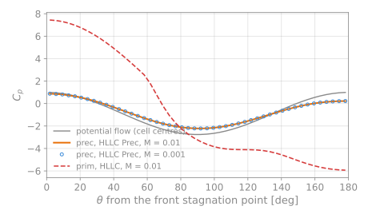

# Low-Mach Cylinder: Preconditioning (CO2)

**Case:** `test/low-mach-cylinder` · **CI test:** `LowMachCylinder`

Inviscid flow of dense CO2 past a circular cylinder at Mach 0.01 and 0.001. With low-Mach preconditioning, the
pressure coefficient does not depend on the Mach number: the two runs agree to $1.1\times10^{-3}$ in $C_p$. Without
preconditioning, the same flow at Mach 0.01 is off by up to 6.6 in $C_p$.

{ width="640" }

*$C_p$ in the first row of cells around the cylinder (upper half). The two preconditioned runs lie on one curve; the
unpreconditioned run has an error of order $1/M$.*

---

## Problem

| Quantity | Value |
|----------|-------|
| Fluid | CO2, $p_\infty = 8$ MPa, $T_\infty = 350$ K, supercritical |
| Compressibility | $Z = 0.74$, $\rho_\infty = 164.2$ kg/m³, $a_\infty = 254.1$ m/s |
| Mach number | 0.01 ($U_\infty = 2.54$ m/s) and 0.001 ($U_\infty = 0.254$ m/s) |
| Geometry | cylinder of radius $R = 0.5$ m, far boundary at $40 R$ |

As $M \to 0$ the flow becomes incompressible, whatever the equation of state. The steady
$C_p = (p - p_\infty)/(\tfrac12 \rho_\infty U_\infty^2)$ then tends to a limit independent of $M$, with corrections of
order $M^2$. For potential flow it is $C_p = 2 (R/r)^2 \cos 2\theta - (R/r)^4$.

An upwind flux adds dissipation proportional to its largest wave speed. Without preconditioning that speed is $a$, and
the pressure fluctuations are of order $M p_\infty$ instead of $M^2 p_\infty$: errors in $C_p$ of order $1/M$. The
preconditioned flux (`HLLC Prec`) scales its dissipation with the reference velocity $U_r$, whose floor
$\varepsilon_\text{min}\, a$ is set to a tenth of the flow speed (`preconditioning-eps-min` $= M/10$). The runs at
Mach 0.01 and 0.001 are then the same problem in scaled variables.

## Model

- Euler equations, planar 2-D, O-grid of $96 \times 48$ cells, the first cell as wide as it is long.
- First order in space, forward Euler with local time steps at CFL 0.8, 3000 iterations.
- Slip wall on the cylinder. On the far boundary: a mass-flux inlet (404) on the upstream third, with the normal mass
  flux $\rho_\infty U_\infty |n_x|$ and $T_\infty$, and an outlet (406) at $p_\infty$ elsewhere.
- CO2 tabulated in $(p, h)$ by ATLAS GPB from CoolProp, $60 \times 60$ points over 7.6–8.4 MPa and 340–360 K.

| Run | `integration-variables` | `riemann-solver` | Mach | `preconditioning-eps-min` |
|-----|------|------|------|------|
| `prec-m2` | `prec` | `HLLC Prec` | 0.01 | $10^{-3}$ |
| `prec-m3` | `prec` | `HLLC Prec` | 0.001 | $10^{-4}$ |
| `prim-m2` | `prim` | `HLLC` | 0.01 | — |

## Results

| Quantity | `prec-m2` | `prec-m3` | `prim-m2` | Potential flow (cell centres) |
|----------|-----------|-----------|-----------|----------------|
| $C_p$ at the front stagnation cell | 0.883 | 0.883 | 7.44 | 0.992 |
| Minimum $C_p$ | −2.219 | −2.220 | −5.93 | −2.754 |
| Pressure residual after 3000 iterations, relative to the first | $2.0\times10^{-2}$ | $2.0\times10^{-2}$ | $4.1\times10^{-3}$ | |

- **Mach independence:** the two preconditioned runs differ by at most $1.1\times10^{-3}$ in $C_p$ for $r < 1.5R$. Their
  pressure residuals differ by a factor $(0.01/0.001)^2 = 100$ within 2.3% over all 3000 iterations: the runs are
  the same in scaled variables.
- **Against potential flow:** within 0.55 on the front half. First-order dissipation separates the flow at the back of the
  cylinder at any Mach number, and the wake lowers the suction at the shoulders.
- **Without preconditioning:** `prim` with `HLLC` converges, but to a solution 6.6 away in $C_p$. That is the
  $1/M$ error of the unpreconditioned flux.

## What this verifies

- Preconditioning (`prec`, `HLLC Prec`, the floor of $U_r$) gives ARES the incompressible limit, in a real fluid.
- The CI test requires: both preconditioned runs to converge (residual below $5\times10^{-2}$ of the first), $C_p$
  Mach-independent to $5\times10^{-3}$, the front half within 0.75 of potential flow, and `prim-m2` off by more than 2.
