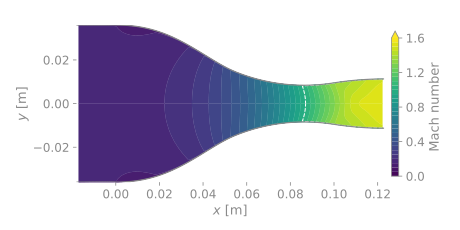
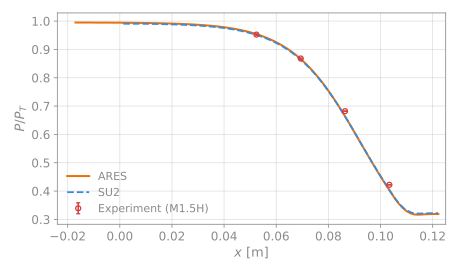
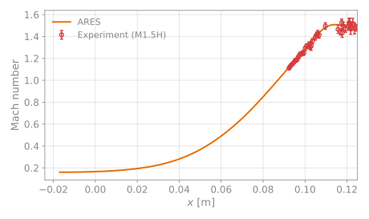

# Non-Ideal Supersonic Nozzle (MDM)

**Case:** `test/compressible-nozzle`

Siloxane MDM vapour expands through a planar converging–diverging nozzle to Mach 1.5. The fluid starts close to its dew line, so the expansion is strongly **non-ideal**. ARES reproduces the measured centreline pressure and Mach number, and agrees with SU2 on the same mesh to within 0.4% of the total pressure.

{ width="640" }

*Mach number, mirrored about the axis. The dashed line is the sonic line ($M = 1$): curved, it crosses the axis just past the geometric throat.*

---

## Problem

The nozzle is the M1.5 test section of the TROVA wind tunnel (Politecnico di Milano), test **M1.5H** of Spinelli et al. (2018). It is the case of the SU2 tutorial *NICFD_nozzle*.

| Quantity | Value |
|----------|-------|
| Fluid | MDM (octamethyltrisiloxane), $T_c = 564.1$ K, $p_c = 14.1$ bar |
| Total state | $P_T = 904\,388$ Pa, $T_T = 542.13$ K |
| Compressibility at inlet | $Z_T = Pv/RT = 0.65$ |
| Throat semi-height | $H = 8.4$ mm, at $x = 0.0864$ m ($x/H = 10.29$) |
| Exit | supersonic, design $M = 1.5$ |

At $Z_T = 0.65$ the ideal-gas law is far off. The critical pressure ratio $P^*/P_T$ rises from 0.60 for the dilute gas ($\gamma = 1.018$) to **0.65** for the real fluid.

## Model

- Planar 2-D, upper half of the nozzle (axis as a symmetry line), $82\times59$ cells.
- RANS with SST, adiabatic no-slip walls.
- MDM from the Helmholtz equation of state of Thol et al. (2017) through CoolProp, tabulated in $(p, h)$. Viscosity and conductivity are the SU2 constants: CoolProp has no transport model for MDM.
- Inlet: the choked mass flux of the isentropic nozzle from $(P_T, T_T)$. ARES then settles at $P_T$ within 0.3%.

## Results

### Centreline pressure

{ width="640" }

| $x$ [m] | Experiment | SU2 | ARES | ARES − exp |
|:-------:|:----------:|:---:|:----:|:----------:|
| 0.0524 | 0.952 | 0.951 | 0.954 | +0.002 |
| 0.0694 | 0.868 | 0.863 | 0.866 | −0.002 |
| 0.0864 (throat) | 0.682 | 0.663 | 0.664 | −0.019 |
| 0.1034 | 0.422 | 0.404 | 0.403 | −0.019 |

- **ARES vs SU2:** the same curve. The largest difference is 0.004 in $P/P_T$.
- **Converging part:** both match the experiment within the measurement uncertainty.
- **Throat and diverging part:** both codes are 0.019 below the taps. The deficit is common to the two solvers, so it comes from the model (equation of state, 2-D flow, wall roughness), not from ARES. Spinelli et al. report deviations of this size at the throat.

The last two taps ($x = 0.137$ and $0.154$ m) lie past the end of the tutorial mesh.

### Centreline Mach number

{ width="640" }

The Mach number from schlieren is matched along the whole diverging part: 35 points, mean difference +0.013, rms 0.025, comparable to the experimental uncertainty (0.01–0.05). The exit Mach number is 1.50.

## What this validates

- The real-fluid $(p,h)$ tables in a **transonic, non-ideal** expansion, close to saturation.
- The choked mass flow and the supersonic expansion with real-gas speed of sound.
- Agreement with an independent code (SU2) on the same mesh and model.

---

## References

1. A. Spinelli, G. Cammi, S. Gallarini, M. Zocca, F. Cozzi, P. Gaetani, V. Dossena, A. Guardone, "Experimental evidence of non-ideal compressible effects in expanding flow of a high molecular complexity vapor," *Exp. Fluids* 59 (2018) 126 — DOI: [10.1007/s00348-018-2578-0](https://doi.org/10.1007/s00348-018-2578-0).
2. SU2 tutorial *Non-ideal compressible flow in a supersonic nozzle* — [su2code.github.io/tutorials/NICFD_nozzle](https://su2code.github.io/tutorials/NICFD_nozzle/).
3. M. Thol, F. H. Dubberke, E. Baumhögger, J. Vrabec, R. Span, "Speed of sound measurements and fundamental equations of state for octamethyltrisiloxane and decamethyltetrasiloxane," *J. Chem. Eng. Data* 62 (2017) 2633–2648 — DOI: [10.1021/acs.jced.7b00092](https://doi.org/10.1021/acs.jced.7b00092).
4. I. H. Bell, J. Wronski, S. Quoilin, V. Lemort, "Pure and pseudo-pure fluid thermophysical property evaluation and the open-source thermophysical property library CoolProp," *Ind. Eng. Chem. Res.* 53 (2014) 2498–2508 — DOI: [10.1021/ie4033999](https://doi.org/10.1021/ie4033999).
