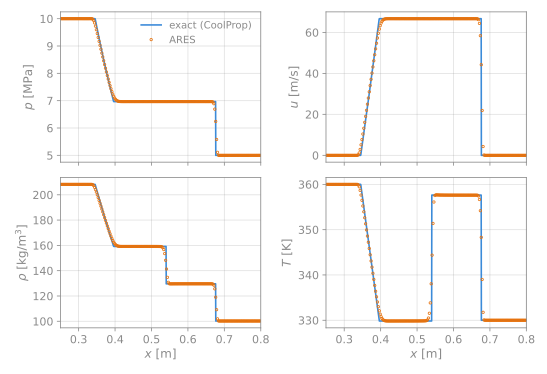

# Real-Fluid Shock Tube (CO2)

**Case:** `test/real-fluid-shock-tube` · **CI test:** `RealFluidShockTube`

A Riemann problem in supercritical CO2, where the ideal-gas law is far off. ARES reproduces the exact solution of the
reference equation of state to 0.02% on both plateaus, and places the shock and the contact within a tenth of a cell.

{ width="700" }

*The solution at $t = 6\times10^{-4}$ s: a rarefaction to the left, the contact at $x = 0.54$ m and the shock at
$x = 0.68$ m. Lines: the exact solution; circles: ARES, 400 cells.*

---

## Problem

A tube of length 1 m, at rest, with a diaphragm at $x = 0.5$ m.

| State | $p$ | $T$ | $\rho$ | $Z$ | $c_p/c_v$ |
|-------|-----|-----|--------|-----|-----------|
| Left  | 10 MPa | 360 K | 208.2 kg/m³ | 0.71 | 2.00 |
| Right | 5 MPa  | 330 K | 100.2 kg/m³ | 0.80 | 1.64 |

The critical point of CO2 is at 7.38 MPa and 304.1 K. Both states are single-phase, and so is every state of the
solution: the isentrope of the left state reaches 304 K at 5 MPa, 17 K above saturation.

## Exact solution

The solution is a left rarefaction, a contact and a right shock. For a general equation of state:

- **Rarefaction:** $u^* = u_L + \int_{p^*}^{p_L} \frac{dp}{\rho a}$ along the isentrope $s = s_L$.
- **Shock:** the Hugoniot $h - h_R = \tfrac12 (p - p_R)\left(\tfrac1\rho + \tfrac1{\rho_R}\right)$, the mass flux
  $m^2 = (p - p_R)/(1/\rho_R - 1/\rho)$, $u^* = u_R + (p - p_R)/m$ and the shock speed $S = u_R + m/\rho_R$.
- $p^*$ is the root of $u^*_L(p) = u^*_R(p)$.

Every state comes from the Span–Wagner equation of state of CO2 through CoolProp (`reference/exact_riemann.py`).

| Quantity | Exact | Ideal gas, $\gamma$ of each state |
|----------|-------|-------------------------|
| $p^*$ | 6.966 MPa | 6.835 MPa (−1.9%) |
| $u^*$ | 66.69 m/s | 56.22 m/s (−15.7%) |
| $\rho^*_L$, $T^*_L$ | 159.18 kg/m³, 329.83 K | |
| $\rho^*_R$, $T^*_R$ | 129.61 kg/m³, 357.63 K | |
| Shock speed | 294.1 m/s | |

The ideal-gas column is the exact solution for two calorically perfect gases with the $c_p/c_v$ and density of the
initial states. Its velocity is 16% lower, far outside the tolerance of the test, so the test also checks the real-fluid
thermodynamics.

## Model

- Euler equations, 1-D: 400 cells, one cell across, symmetry on the side faces and slip walls at the ends, which the
  waves do not reach.
- MUSCL with the van Leer limiter, HLLC, `prim` variables, RK3 at CFL 0.8: 99 steps.
- CO2 tabulated in $(p, h)$ by ATLAS GPB from CoolProp, $60 \times 60$ points over 4.5–10.5 MPa and 300–400 K.

## Results

| Plateau | $p$ | $u$ | $\rho$ | $T$ |
|---------|-----|-----|--------|-----|
| Rarefied gas (left of the contact) | 0.01% | 0.02% | 0.00% | 0.00% |
| Shocked gas (right of the contact) | 0.01% | 0.02% | 0.01% | 0.00% |

*The largest deviation from the exact value over the plateau cells, away from the smeared waves.*

| Wave | ARES | Exact | Difference |
|------|------|-------|------------|
| Shock ($p$ halfway between $p^*$ and $p_R$) | 0.67723 m | 0.67695 m | 0.11 cells |
| Contact ($\rho$ halfway between $\rho^*_L$ and $\rho^*_R$) | 0.54013 m | 0.54012 m | 0.00 cells |

The waves are located at the time of the last step, which ends past the requested $6 \times 10^{-4}$ s.

## What this verifies

- The $(p, h)$ tables and their derivatives give the right wave speeds and jump conditions in a dense, non-ideal gas.
- The scheme is conservative across the shock: the Hugoniot state and the shock speed come out right.
- The CI test requires the plateaus within 0.5% and the waves within one cell.
